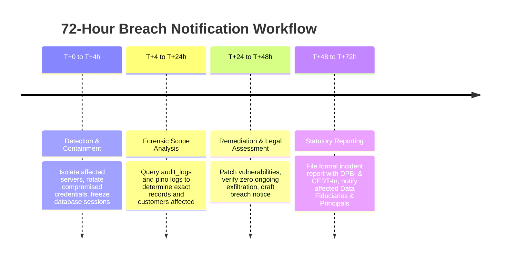

# DPDP Incident Runbook — 72-Hour Personal Data Breach Workflow

**Document Version:** 1.0  
**Compliance Authority:** Digital Personal Data Protection Act 2023 (DPDP Act) & CERT-In Cybersecurity Directions  
**Target SLA:** Mandatory notification to the Data Protection Board of India (DPBI) and affected Data Principals within **72 hours** of confirmed breach.  
**Reference:** `docs/ARCHITECTURE.md` §22, §23

---

## 1. Roles & Incident Team

| Role | Responsibility | Primary Contact |
|---|---|---|
| **Incident Commander (IC)** | Coordinates response, timelines, and technical mitigation | Lead Systems Architect / CTO |
| **Data Protection Officer (DPO)** | Legal evaluation, DPBI reporting, and customer notice drafting | Legal Counsel / DPO |
| **Security Engineer** | Log analysis, forensic imaging, and exploit containment | Platform Security Lead |
| **Communications Lead** | Coordination with restaurant partners (Data Fiduciaries) | Head of Operations |

> **Note on Roles:** Under DPDP Act 2023, the restaurant partner is typically the **Data Fiduciary** and Dineflow acts as the **Data Processor**. Dineflow must immediately notify the Data Fiduciary upon discovering any security incident affecting customer data so that the Fiduciary and Processor can jointly fulfill statutory reporting.

---

## 2. 72-Hour Response Timeline



---

## 3. Step-by-Step Procedure

### Phase 1: Detection & Immediate Containment (T+0h to T+4h)
1. **Declare Incident:**
   - Create private incident bridge (`#incident-p1-breach-yyyy-mm-dd`).
   - Log all timeline entries in UTC.
2. **Isolate Affected Systems:**
   - If database credentials or token keys compromised: immediately trigger KMS secret rotation.
   - If an API token or session stolen: revoke sessions via `staff_refresh_tokens.is_revoked = true` or `customer_refresh_tokens.is_revoked = true`.
   - If an infrastructure node compromised: terminate and replace container instances via blue/green deployment.
3. **Preserve Forensic Evidence:**
   - Snapshot database state, WAL logs, and Redis audit buffers.
   - Lock append-only tables (`audit_logs`, `privacy_requests`, `order_events`).

### Phase 2: Impact Assessment (T+4h to T+24h)
1. **Query Affected Tenant & Customer Records:**
   - Identify affected `org_id`s:
     ```sql
     SELECT DISTINCT org_id, count(*) 
     FROM privacy_requests 
     WHERE created_at >= NOW() - INTERVAL '24 hours' 
     GROUP BY org_id;
     ```
   - Determine categories of data compromised (e.g. phone numbers, order amounts, payment references).
   - Invariant: Payment card numbers, CVVs, and UPI MPINs are **never stored** in Dineflow databases.
2. **Assess Severity:**
   - Level 1: System error, no personal data exfiltrated.
   - Level 2: Limited non-sensitive operational data accessed.
   - Level 3 (DPDP Trigger): Confirmed unauthorized access or exfiltration of phone numbers, names, or order histories.

### Phase 3: Remediation & Verification (T+24h to T+48h)
1. Deploy code fixes and regression test via CI pipeline.
2. Verify zero active unauthorized database connections.
3. Review firewall, WAF, and PostgreSQL connection logs (`SELECT * FROM pg_stat_activity;`).

### Phase 4: Statutory Notification to DPBI & CERT-In (T+48h to T+72h)
1. **Mandatory Reporting to Data Protection Board of India (DPBI):**
   - Submit formal notification containing:
     - Nature, extent, and cause of personal data breach.
     - Approximate number of data principals affected.
     - Potential consequences and mitigation measures taken.
     - Contact details of Dineflow Data Protection Officer (DPO).
2. **CERT-In Cyber Incident Reporting:**
   - Report within 6 hours of cybersecurity incident confirmation per CERT-In directions.

### Phase 5: Notification to Restaurant Fiduciaries and Diners
1. Send automated WhatsApp / Email notice via pre-approved template:
   > *"Notice from [Restaurant Name]: We detected unauthorized access to our dining session records on [Date]. Your payment credentials and cards were NOT involved. We have taken immediate action to secure all systems. For questions, contact [DPO Contact]."*
2. Publish incident advisory on Dineflow Trust Center.

---

## 4. Post-Incident Review
- Convene blameless post-mortem within 5 business days.
- Update threat model in `docs/threat-model.md`.
- File completed report in compliance audit folder.
